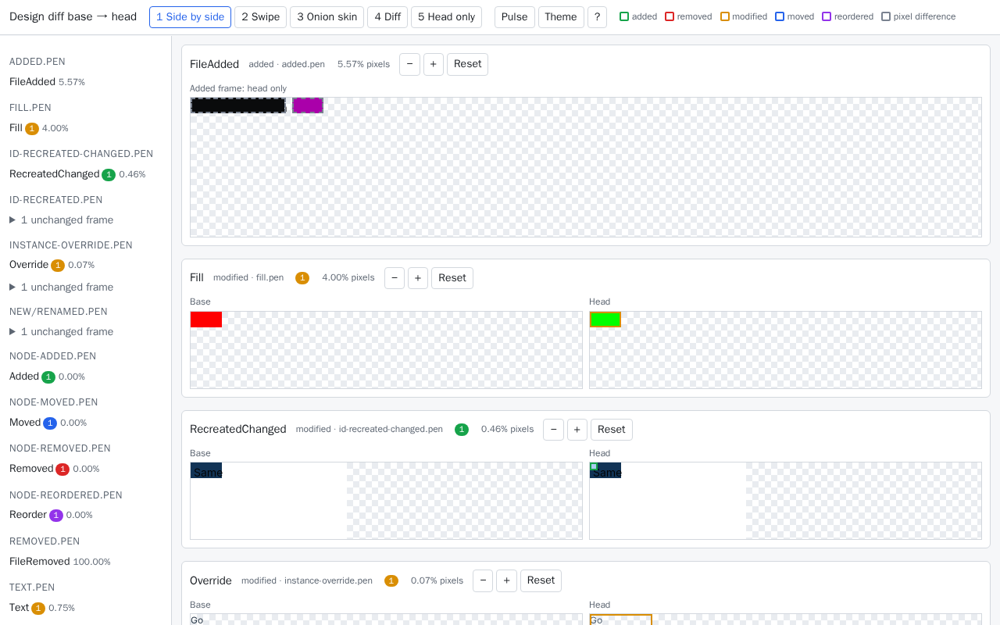

# design-gates

Deterministic design review for `.pen` files: visual diff between versions and gates over the design JSON.

## Development

- `src/` — library (`index.ts`) and CLI (`cli.ts`) sources.
- `test/` — `*.test.ts` files run by `node:test`; helpers live in `test/helpers/` and are not tests.

Scripts:

- `npm run build` — clean `dist/` and compile with `tsc` (output in `dist/src`, `dist/test`).
- `npm test` — build, then run `dist/test/**/*.test.js`.

CI: `.github/workflows/ci.yml` runs `npm ci` and `npm test` on Node 22 and 24 for every pull request and push to `main`.

Dev dependencies (`typescript`, `@types/node`) are pinned to exact versions; the lockfile is `package-lock.json`.

## Fixtures and the pen loader

- `fixtures/` (repo root) holds sample `.pen` documents, e.g. `fixtures/minimal.pen`. Tests resolve it with `new URL('../../../fixtures/', import.meta.url)` from the compiled `dist/test/helpers/` (see `test/helpers/fixtures.ts`), never `process.cwd()`. Any bundled fonts must ship their licence text alongside (e.g. `fixtures/fonts/OFL.txt`).
- `src/pen/` is the `.pen` loader: `parsePen(text)` parses JSONC (comments and trailing commas allowed) into a typed `PenDocument`, and `loadPenFile(path)` reads a file. Invalid input throws an `Invalid .pen document` error. Types and loader are exported from `src/index.ts`.

## Rendering

- `src/render/renderer.ts` defines the `Renderer` interface (`renderFrame(doc, frameId, { scale, theme? })` → `{ png, width, height, nodeBoxes }`). Everything OpenPencil-specific lives in `src/render/openpencil.ts` (`createOpenPencilRenderer({ scale?, fontsDir? })`, default scale 1).
- Engine: [`@open-pencil/core`](https://github.com/open-pencil/open-pencil) (MIT), pinned to an exact version in `package.json`. It runs headless on CanvasKit WASM: no display, GPU or native build needed. Nothing depends on pen.dev, its MCP server or `@pen.dev/cli`.
- Flow: the `PenDocument` is deep-copied, the requested theme is pinned on the frame, `$variable` references (including alias chains; cycles throw) are resolved to literals for the theme in effect (OpenPencil 0.16's importer ignores `theme` pins when resolving variables and only understands an axis literally named `theme`), then `parsePenFile` builds the scene graph and `headlessRenderNodes` renders the frame to PNG. The caller's document is never mutated and no temp files are written.
- Fonts: Inter Regular/Medium/SemiBold/Bold from `fixtures/fonts/` (licence: `fixtures/fonts/OFL.txt`) are registered in OpenPencil's font manager and online font providers are disabled, so rendering never falls back to system or network fonts.
- Layout info: OpenPencil exposes laid-out geometry per scene node (`graph.getAbsoluteBounds(id)`); node ids equal the `.pen` ids. `nodeBoxes` is that box for every node of the frame, relative to the frame origin and multiplied by `scale`. The `.pen` importer leaves auto-sized text at width 0 outside auto-layout containers, so those text nodes are sized with OpenPencil's own `estimateTextSize` (measured with the registered fonts) before rendering. Nodes that OpenPencil does not create (e.g. `prompt`) have no box.
- Gotcha: in `.pen`, frames default to a horizontal auto layout; fixtures that need absolute child positions set `"layout": "none"`.
- Limits: only variable references whose whole string value is `$name` are resolved; an instance's reusable component is themed by where the component lives, not where the instance sits.

Theme handling: `renderFrame` accepts `theme` (axis -> value, e.g. `{ mode: "dark" }`). `src/render/themes.ts` renders a deep copy of the document whose frame carries that `theme` (any `.pen` node may pin a theme, inherited by its subtree), so the caller's document is never mutated and no OpenPencil theme API is needed.

## Development notes: dependency pin

`@open-pencil/core` is pinned to `0.16.0` because `0.15.1` depends on `expr-eval@2.0.2` (CVE-2026-12866, CVSS 9.8, unmaintained since 2019, no fixed release) and this library parses untrusted `.pen` input. `0.16.0` has no `expr-eval`; `test/lockfile.test.ts` fails if it reappears in `package-lock.json`. The only catch is age: `0.16.0` and `twirlwind@0.4.1` reach 7 days old on 2026-10-21, after which `npm ci` works behind the operator's registry (cve-policy).

## Figma support

A `.fig` file is parsed with OpenPencil's reader and normalized to the same document the `.pen` format gives (`src/fig/`), so the diff, the compiler and the rules need no Figma code. Node ids are the Figma GUIDs. The top-level `children` are the layers of every page in page order (pages are not nodes). The document `version` is the `.pen` version the compiler accepts (`2.6`); the fig-kiwi version of the file is `DesignSource.figVersion`.

| Figma construct | Support | What the normalizer does |
| --- | --- | --- |
| File form: Save local copy (zip) / bare fig-kiwi | mapped | Both are read. The committed fixtures are the zip form, which is what OpenPencil's writer produces |
| Real Figma files | verified manually | Verified manually by the operator, not in CI; CI only sees the generated fixtures |
| FRAME, GROUP, RECTANGLE, ELLIPSE, TEXT | mapped | `frame`, `group`, `rectangle`, `ellipse`, `text` |
| COMPONENT | mapped | `frame` with `reusable: true` |
| INSTANCE | mapped | `ref` to the component id, no `children` |
| Instance overrides | partial | `descendants`, keyed by "/"-joined ids of the component's own nodes, for text, paints, strokes, effects, visibility, opacity, corner radius, text style, layout and geometry. Highlight boxes for an overridden sublayer fall back to the instance box. Sublayers added or removed in an instance are only counted (`figUnmappedOverrides`). Swapped nested components, component properties and variants are not mapped. An instance whose component is not in the file is kept as a `frame` with `figType: "INSTANCE"` and its own layers |
| VECTOR, BOOLEAN_OPERATION, STAR | partial | `path`, `figType` set; geometry is not mapped, so only position, size, paints and the common properties are seen |
| POLYGON, LINE, CONNECTOR | partial | `polygon` / `line`, `figType` set; geometry not mapped |
| ROUNDED_RECTANGLE | partial | `rectangle`, `figType` set |
| SECTION, COMPONENT_SET, SHAPE_WITH_TEXT | partial | `frame`, `figType` set (SHAPE_WITH_TEXT text is not mapped) |
| Solid fills and strokes | mapped | `"#rrggbb"`, or `"#rrggbbaa"` when not opaque (paint opacity included); a hidden paint is an object with `enabled: false`; several paints are a list, bottom to top |
| Gradient fills | partial | `{ type: "gradient", gradientType, stops, transform }`; rules treat it as `unknown` (not solid) |
| Image fills | partial | `{ type: "image", imageHash, scaleMode }`; a changed image is a changed hash, so a semantic `modified` fill. The image itself is not read |
| Video, pattern, noise fills | partial | `{ type: "unsupported", paintType }` |
| Paint blend modes | partial | Non-normal blend modes are kept as `blendMode` |
| Strokes | partial | Weight (per side when independent), alignment, colour/paint, join, cap, dash pattern. Miter limit is not mapped |
| Effects | partial | Shadows (`type: "shadow"`, inner or outer) and blurs (`type: "blur"`, layer, background or foreground). Blend modes and "show behind" are not mapped |
| Auto layout | partial | Direction, gap, padding, primary and counter alignment, wrap. Hug/fill sizing, counter-axis gap, min/max size, absolute positioning and constraints are not mapped. Grid layout is only `layout: "grid"` |
| Size, position, rotation, opacity, visibility, clip, corner radius | mapped | `width`/`height`/`x`/`y` (parent-relative), `rotation`, `opacity`, `enabled: false`, `clip`, `cornerRadius` (a number or four corners) |
| Text content and style | partial | `content`, family, size, weight, italic, line height, letter spacing, alignment, growth, decoration, case, and mixed-style runs as `styleRuns`. Fonts' variations/features, lists, hyperlinks and truncation are not mapped |
| Variables | mapped | `variables`, named `<collection>/<variable name>` with whitespace and `$` as `-` and later duplicates suffixed `-2`, `-3` (in file order). Value is one `{ value, theme: { <collection>: <mode> } }` per mode, in mode order; aliases are `$name`. Types `color`, `number`, `string`, `boolean` |
| Variable collections and modes | mapped | `themes`: axis is the collection name, values are the mode names |
| Explicit variable mode on a node | mapped | The node's `theme` pin |
| Variables bound to fields | partial | Fill and stroke colours, gap, padding, corner radius, font size and family, opacity (as `$name`). Other bound fields (width, height, effects, text fields of single runs) are not mapped |
| Styles (shared fill/text/effect styles) | not mapped | Their resolved values are on the nodes; the style link is not kept |
| Moving a frame between pages | not mapped | Pages are not nodes, so only the frame's own properties are compared |
| Constraints, layout grids, guides, masks, export settings, plugin data, prototype links, comments | not mapped | Left out of both sides, so they never change a diff |
| Library (published) components and variables | not mapped | Only what is in the file is read |

Component, instance-subtree and some other nodes come back from OpenPencil's reader without a Figma GUID. For those the id is the reader's own (file-order) id, which can differ between two versions of a file, so the diff may report such a node as removed and added.

Regenerate the fixtures in `fixtures/fig/` (written by OpenPencil's own `.fig` writer from scenes built in `test/helpers/fig-fixtures.ts`; deterministic, no network) with `npm run fixtures:fig`. The test suite regenerates them in memory and compares the parsed scenes with the committed files. The script needs no new dependency; it uses the already-installed `@open-pencil/core`, and `npm run fixtures:fig` builds first.

### Workflow

In Figma use **File > Save local copy** to get a `.fig`, put it in your design folder and commit it to git. There is no conversion step: `design-gates diff` and `design-gates check` read the `.fig` from git directly, and the `design` CLI (`save`, `status`, `compare`, `restore`) treats `.fig` exactly like `.pen`. A `.fig` is always read and written as bytes, so `design restore` brings a file back byte-identical. A rename between `.pen` and `.fig` is shown as one file removed and one added.

On a `.fig` the gates run on the normalized document. SCH-001 validates it against the fig format. A construct the gates cannot judge (for example a gradient fill, or geometry that is not mapped) gives `review`, never `block`.

Out of scope: Figma cloud files, the REST API and access tokens; converting between `.fig` and `.pen`; writing `.fig` files; Figma plugins.

## Computing a semantic diff

```ts
import { computeSemanticDiff, serializeDiff } from "design-gates";

// base defaults to `git merge-base main HEAD`; head defaults to the working tree
// (uncommitted edits and untracked .pen files included).
const result = await computeSemanticDiff({ repo: ".", base: "main", head: "HEAD", paths: ["designs/**/*.pen"] });
const json: string = serializeDiff(result); // deterministic JSON
```

`computeSemanticDiffWithDocs` additionally returns the parsed base/head documents (`DiffDocs`, keyed by file path) for the visual diff. Git is only read (`--no-optional-locks`); the repo, index and HEAD are never modified. Pass `git` to inject a custom `GitReader`.

## Visual diff

`computeVisualDiff({ result, docs, renderer, outDir, scale, threshold })` renders every
`modified`/`added`/`removed` frame (plus frames listed by a variable or theme change) at base and
head with the injected `Renderer`, writes `images/<file-slug>/<frameId>[-<theme>]-<8 hex hash>-{base,head,diff}.png`
under `outDir`, and fills `images`, `pixelDiffRatio` and `changeBoxes` (node boxes plus `pixel`
regions) per theme key. `file-slug` is the sanitized path plus the first 8 hex chars of its sha256.
Sizes that differ are padded top-left onto a transparent common canvas. Added/removed frames are
diffed against a blank canvas.

Every frame is rendered in the default theme and in each theme of a variable change that lists it.
The pixel threshold defaults to 0.1 (pixelmatch, anti-aliasing ignored), so tiny colour shifts
give a ratio of 0 unless a lower `threshold` is passed. A node the renderer
gives no box for is listed in `missingBoxes` instead of getting an invented box.

## Install

Node >= 22. From a checkout: `npm ci && npm run build`; this provides the `design-gates` binary (`dist/src/cli.js`, e.g. `npx design-gates`). The renderer is [`@open-pencil/core`](https://github.com/open-pencil/open-pencil), pinned to exactly **0.16.0** (see the dependency pin note above); it runs headless, so no browser or display is needed to produce a diff.

## CLI

```
design-gates diff [--repo <path>] [--base <ref>] [--head <ref>] [--out <dir>]
                  [--threshold <0..1>] [--scale <n>] [--inline] [paths...]
```

| Flag | Default | Meaning |
| --- | --- | --- |
| `--repo <path>` | current directory | Git repository to diff. |
| `--base <ref>` | merge-base of `main` and `HEAD` | Base ref (anything that resolves to a commit). |
| `--head <ref>` | the working tree | Head ref. By default uncommitted edits and untracked `.pen` files are included. |
| `--out <dir>` | `./design-diff` (relative to the cwd) | Output directory. |
| `--threshold <0..1>` | `0.1` | pixelmatch colour threshold; lower values detect subtler colour shifts. |
| `--scale <n>` | `1` | Render scale (device pixels per design pixel), `0 < n <= 8`. |
| `--inline` | off | Embed the images in `report.html` as data URIs, so the report is one file. |
| `paths...` | all `.pen` files | Glob pathspecs (relative to the repo root) narrowing the files considered. |

Output: `<out>/report.html`, `<out>/diff.json` and `<out>/images/<file-slug>/<frameId>[-<theme>]-<8 hex hash>-{base,head,diff}.png` (the images are always written; `--inline` additionally embeds them). A short summary (files, frames and changes counts plus the report path) goes to stdout.

Exit codes: `0` whenever the diff ran, including when it found changes or no `.pen` changes at all (an empty report and `diff.json` are still written). `1` on errors (bad ref, not a git repository, render or write failure) and `2` on invalid arguments; the message goes to stderr and nothing is written to `<out>`.

Safety: the repository, its index and HEAD are only read. The sole exception to "never write into the repo" is the default `./design-diff` output when run from inside a worktree. `--out` is refused when its real path (symlinks resolved through the deepest existing ancestor) lies inside the repo's `.git` directory (`--absolute-git-dir` or `--git-common-dir`). Renders go to a temp directory under `os.tmpdir()` which is always removed, even on error, and are copied to `<out>/images` only after everything succeeded. `--out` and every existing path component between the repo (or cwd) and it are refused when they are symlinks, unless `--out` is absolute and outside the repo; image writes use `O_NOFOLLOW`. `<out>/images` is cleared before a re-run only when `<out>/diff.json` from a previous run exists.

Example on the fixture repo (`test/helpers/fixture-repo.ts` builds one with tags `base` and `head`): `npx design-gates diff --base base --head head`.

## `diff.json`

`schemaVersion: 1`, then `base` / `head` (`{ref, sha}`; the head sha is `"WORKTREE"` for the working tree), `files`, `variables`, `themes`.

- `files[]`: `path`, optional `oldPath` (renames), `status` (`added | removed | modified | renamed`), `frames[]`.
- `frames[]`: `id`, `name`, optional `baseId`/`headId`, `status` (`added | removed | modified | unchanged`), `matchedBy` (`id | name | structure | null`; frames whose ids were recreated are matched by structure or a unique name), `counts` (`added, removed, modified, moved, reordered`), `nodes[]`, `changeBoxes[]`, `missingBoxes[]`, `pixelDiffRatio` and `images`.
- `nodes[]`: `id`, `name`, `type`, `change` (`added | removed | modified | moved | reordered`), `props[]` (`{path, old, new}`; instance overrides use paths like `descendants.label.fill`), and `from`/`to` parents for moves.
- `changeBoxes[]`: `x, y, w, h` in frame pixels at the chosen scale, `kind` (a change kind or `pixel` for regions found by the pixel diff), `side` (`base | head`), optional `nodeId`/`name`. `missingBoxes[]` lists changed node ids the renderer produced no layout box for (no box is invented; the report shows a note).
- `pixelDiffRatio`: changed pixels / total pixels per theme key; `images`: relative `images/...` paths (`base`, `head`, `diff`) per theme key. Both are `null` for frames that were not rendered. Theme keys are `default` or `axis=value` pairs sorted by axis and joined with `,` (e.g. `mode=dark`). A frame affected by a per-theme variable change is rendered in the default theme and in every theme the change lists, so a dark-only edit shows `{"default": 0, "mode=dark": 0.12}`.
- `variables[]`: `file`, `name`, `change` (`added | removed | modified`), optional `theme`, `old`/`new`, `frames[]` (`{file, frameId}` of affected frames, including frames that only contain an instance of a component using the variable). `themes[]`: theme axes added or removed, same shape.

Ordering guarantees: files by path; frames by id; nodes by id then change kind (`added, removed, modified, moved, reordered`); variables by file, name, theme; frame refs by file then frame id; `missingBoxes` sorted; theme-keyed records list `default` first, then keys alphabetically; object keys inside prop values are sorted; fixed key order, 2-space indent, one trailing newline.

## The report

`report.html` is a single self-contained file: inline CSS and JS, no external URLs, works offline. With `--inline` the images are embedded too; otherwise it references `images/...` next to it, so keep the folder together.

- **Summary** (below the top bar): "N changes in M frames: x added, y removed, ..." with the non-zero kinds in a fixed order, plus changed variables and themes. Each kind links to the first frame that has it. A frame added or removed as a whole counts as one added/removed change; with nothing changed it says "No changes".
- **Change list** (under every frame header, always visible): one plain-language line per change, e.g. `Button / fill: #FF0000 -> #00FF00`, `Title / text: 'Hello' -> 'Olá'`, `Card moved 24px right, 8px down` (x/y changes are combined), `Card moved from Header to Footer`, `Card added`, `Card reordered`, and `variable color.bg (dark): #000000 -> #444444` or `theme dark added` for variable-driven changes. Nodes without a name show their id. Clicking a line (or Enter on it) selects the matching marker and turns markers back on if they were hidden. Known limitation: a moved node's parent is shown by name only when that name is in the diff (a changed node, or a frame); otherwise the raw id is shown.
- A frame that is only here because a variable or theme changed reads "changed via variable ..." instead of "unchanged". The pixel ratio is a secondary detail ("pixels changed: 1.23%"); when it is zero the report says "no visible pixel change" with a short reason, never a bare 0.00%.
- Panes are labelled **Before** and **After**. Views (buttons with tooltips, or keys `1`-`5`): **side by side**, **swipe** (a slider wipes between Before and After), **onion skin** (opacity slider), **diff** (the pixelmatch mask) and **After only**. Added/removed frames show only the side that exists.
- Markers are borderless highlighter tints over each change, coloured by kind, and the legend spells them out: green added, red removed, amber modified, blue moved, purple reordered, hatched grey for pixels changed with no matching node. Press `m` (or the **Markers** button) to hide or show them. **Pulse** toggles a short pulse animation (disabled under `prefers-reduced-motion`).
- Hover (or focus) a marker for details: node name, type, change and the old/new property values.
- Each frame is zoomed to fit on load; zoom with the wheel or the `+`/`-` buttons, pan by dragging, `Reset` re-fits. Zoom and pan are shared between the Before and After panes of a frame.
- Frames with themed renders get a theme switcher with each theme's pixel ratio; the sidebar badges the themes that changed. Frames with `missingBoxes` show a "no layout box" note.
- Sidebar: changed frames per file with change-count badges and pixel ratio, truly unchanged frames collapsed, and a Variables & themes section linking to affected frames.
- Keyboard: `j`/`k` (or arrows) next/previous marker, `n`/`p` next/previous frame, `m` markers, `1`-`5` views, `?` help, `Esc` closes help. A button toggles light/dark; the default follows `prefers-color-scheme`.



## Design versions (`design` CLI)

`design` keeps versions of the `.pen` files in a folder, entirely on your computer. Run it inside the design folder, or point it there with `--repo <folder>`. Add `--json` to any command to get one machine-readable result instead of a sentence. `design --help` lists every command.

A first session in five steps:

1. `design init` starts keeping versions (safe to run again). Existing designs are saved as the first version.
2. `design save -m "Bigger header"` saves your changes as a new version. `design status` shows what is not saved yet; `design history` lists versions, newest first.
3. `design compare #2 #1 --open` builds a visual report of what changed between two versions and opens it. With no versions it compares your last version with your unsaved changes.
4. `design explore bolder-colours` starts a separate line of experiments; `design switch main` returns to the original line. Save before switching.
5. `design restore #2` brings the designs back to how they were in version #2. Nothing is erased: the restored files show up as unsaved changes, so you can save them as a new version. `--save-first` saves your unsaved work before restoring.

Version references: `#n` (`#1` is the newest version), a version id (4 or more characters of it), the name of an exploration, or `main`. In `compare`, words are read left to right: up to two leading words that are version references are the versions; the first word that is not one, and everything after it, is a file. A reference that could mean several things is an error (use `#n` or a longer id).

Exit codes: `0` worked (including "nothing to save"); `1` stopped by a safety rule, saving was refused (for example by signing or a hook), or an unexpected failure; `2` the command was not understood, or a version could not be found. With `--json`, errors also print `{"error": "...", "code": n}` on stdout.

Safety promises: everything stays local (nothing is pushed or uploaded); earlier versions are never rewritten or deleted; your global git configuration is never touched (a local name and email are set in the folder only when missing).

### Agent skill

`skills/design-cli/SKILL.md` is an [Agent Skill](https://docs.claude.com/en/docs/claude-code/skills) that teaches an AI agent to use the `design` CLI safely (always `--json`, exit codes, no direct git). To install it, copy the `skills/design-cli` folder into a project's `.claude/skills/` or into `~/.claude/skills/`.

## Gates

`design-gates check` runs a deterministic rule engine over `.pen` documents (phase 1: SCH-001/002/003, TOK-001, TOK-002, A11Y-001, CMP-001, DIF-001). This section is the foundation: the compiler, the config model and the rule registry. Rules are pure functions of the compiled document, the config and an optional diff; they never read the clock or the network.

### Rules

| Rule | What it checks | Severity | Config | Fix |
| --- | --- | --- | --- | --- |
| `A11Y-001` | Text contrast against the effective background (ancestor fills alpha-composited down to an opaque one, else `canvasColor`), per theme combination; a gradient is checked at every stop. 4.5:1, or 3:1 for large text (>= 24px, or >= 18.66px bold). One `block` violation per failing combination, with a `theme`. An image or shader background yields `review`. A result fully inside a component is reported once on it with `affectedInstances`. At most 16 combinations are evaluated per text node; beyond that exactly one `info` violation lists the evaluated and skipped combinations. | `block` | `minRatio` (4.5), `minRatioLarge` (3) | none |
| SCH-001 | Invalid document: duplicate node id, id containing `/`, unknown node `type`; an unknown document `version` is a `warn` (the check ran in degraded mode; severity cannot be overridden). A file that cannot be parsed is a file-level block with empty `nodeId` and `path`. | block (`warn` for version) | `severity` | none |
| SCH-002 | Broken reference: `ref` to a missing or non-reusable node, `descendants` path missing in the expanded component, reference cycle. | block | `severity` | none |
| SCH-003 | Broken variable: undefined `$name`, alias cycle (message lists the chain), escaped variable string `"\\$name"`. | block | `severity` | escaped variable: `replace` with `$name` |
| CMP-001 | Detached instance (exact only): a non-`ref` subtree outside any component whose component-mode `structureHash` equals a reusable component's (same shape and styling; names and text ignored) and that has at least `minNodes` nodes. Only the outermost match is reported; with several matching components the smallest id is used and the others are listed in the message. | warn | `severity`, `minNodes` (default 3) | `ref` with `descendants` holding the new text `content`, keyed by slash-separated id path |
| DIF-001 | Blast radius, only with `--base`: a changed reusable component (compared by its own props and children, nested components on their own) with its transitive instances and the screens containing them; a changed variable or theme value with the affected nodes per theme. | warn at `warnAt`, block at `blockAt`; block is warn when in `scope` | `severity`, `warnAt` (5), `blockAt` (20), `scope` (`[]`, ids/names, `*` glob; `--scope` adds to it) | none |
| TOK-001 | Hard-coded value: a literal (not a `$variable`) in fill, stroke (colour), `effect.color`, `cornerRadius`, `gap`, `padding`, `fontSize`, `strokeWidth` (`stroke.thickness`, a number or per-side object) or `fontFamily`. Colours are read through the solid-paint reader, so a gradient or image is not reported. A literal inside a component is reported once on the node that defines it, with `affectedInstances`; instance overrides are reported on the instance. | `block` for colours and `fontSize`, `warn` otherwise | `severity`, `properties` (all nine names above), `ignoreValues` (per property; plain strings, or `/regex/` strings of at most 200 characters and without nested quantifiers such as `(a+)+` (best-effort check; rejected as a config error), for example `{ "fill": ["transparent", "/^#00/"] }`), `onlyIn` (top-level frame names or ids, `*` glob; `[]` = all) | one variable has the value in the node's theme: `replace` with `$name`; several: `candidates` sorted by name; none: no fix |
| TOK-002 | Off-scale numeric value: `gap` and `padding` (spacing), `cornerRadius` (radius), `fontSize`, `strokeWidth`. Checks literals and numeric variable definitions read by those properties (reported on the variable, `nodeId` `$name`, once per category and themed entry, not again where it is used). | `warn`; `block` when the top-level `strict` is `true` | `severity`, `scales` (`spacing` `{ "base": 4 }`, `radius` `{ "base": 2 }`, `strokeWidth` `[1, 2, 4]`, `fontSize` `[12, 14, 16, 20, 24, 32, 40, 48]`; a category is `{ "base": n }` or a list), `tolerance` (0), top-level `strict` (`false`) | `candidates`: the nearest allowed value, or both neighbours in ascending order when equidistant (`gap: 18`, base 4: `[16, 20]`) |

### Severities

- `block`: fails the run (the only severity that can).
- `warn`: reported; never fails the run.
- `review`: needs a human look; never changed by config.
- `info`: purely informational; never changed by config.

`rules.<ID>.severity` sets `block`, `warn`, `review`, `info` or `off` (rule skipped). An override only changes violations a rule emits at `block` or `warn` and does not pin (`fixedSeverity`); `review` and `info` violations are never escalated or demoted.

### Config

`design-gates.config.json` (all keys optional; `strict` only escalates the rules that say so (TOK-002 warn -> block), the exit code still fails only on `block`; `DIF-001.scope` lists component ids/names or variable names (`*` glob) whose block is downgraded to warn; `TOK-001.ignoreValues` is per property, a `/.../` string being a regex; `TOK-002.scales` takes `{ "base": n }` or a list per category; unknown top-level keys or rule ids are an error). Defaults:

```json
{
  "canvasColor": "#FFFFFF",
  "strict": false,
  "rules": {
    "A11Y-001": {
      "minRatio": 4.5,
      "minRatioLarge": 3
    },
    "CMP-001": {
      "minNodes": 3
    },
    "DIF-001": {
      "warnAt": 5,
      "blockAt": 20,
      "scope": []
    },
    "SCH-001": {},
    "SCH-002": {},
    "SCH-003": {},
    "TOK-001": {
      "properties": [
        "fill",
        "stroke",
        "effect.color",
        "cornerRadius",
        "gap",
        "padding",
        "fontSize",
        "strokeWidth",
        "fontFamily"
      ],
      "ignoreValues": {},
      "onlyIn": []
    },
    "TOK-002": {
      "scales": {
        "fontSize": [
          12,
          14,
          16,
          20,
          24,
          32,
          40,
          48
        ],
        "radius": {
          "base": 2
        },
        "spacing": {
          "base": 4
        },
        "strokeWidth": [
          1,
          2,
          4
        ]
      },
      "tolerance": 0
    }
  }
}
```

`rules.<ID>` also accepts `severity`. Unknown option keys under a known rule are kept for later rules to read; known keys of the wrong type are an error.

| Key | Default | Meaning |
| --- | --- | --- |
| `canvasColor` | `"#FFFFFF"` | Colour assumed behind top-level frames for contrast. |
| `strict` | `false` | Escalates the rules that say so (TOK-002 warn -> block). |
| `rules.<ID>.severity` | the rule's default severity (see Rules) | `block`, `warn`, `review`, `info` or `off`; `off` disables the rule (for SCH-001 it also silences the "suppression without reason" report). |
| `rules.A11Y-001.minRatio` / `minRatioLarge` | `4.5` / `3` | Minimum contrast ratio for normal / large text. |
| `rules.CMP-001.minNodes` | `3` | Minimum subtree size for a repeated structure to be reported. |
| `rules.DIF-001.warnAt` / `blockAt` | `5` / `20` | Change thresholds for warn / block. |
| `rules.DIF-001.scope` | `[]` | Scope ids; `--scope` appends to it. |
| `rules.TOK-001.properties` / `ignoreValues` / `onlyIn` | see JSON above | Checked properties, per-property ignored literals, frames to check. |
| `rules.TOK-002.scales` / `tolerance` | see JSON above / `0` | Allowed values per category; accepted distance from a scale value. |

### CLI: `design-gates check`

```
design-gates check [paths...] [--base <ref>] [--format agent|sarif|text] [--config <file>]
                   [--update-baseline] [--scope <id>]...
```

Runs every registered rule (so new rules need no CLI change) over the `.pen` files of the repository in the current directory: tracked and untracked, not git-ignored. Only files inside the repo root are read (symlinks are resolved and must stay inside it); `file` in every output is a repo-relative POSIX path.

| Flag | Default | Meaning |
| --- | --- | --- |
| `paths...` | all `.pen` files | Glob pathspecs relative to the repo root narrowing the files; a path outside the repo is a usage error. |
| `--base <ref>` | none | Compile the base version of each file and give the rules a diff context (`base`, `head`, variable changes); only diff-aware rules such as DIF-001 use it. An invalid ref is a usage error. |
| `--format <fmt>` | `agent` | `agent`, `sarif` or `text`, written to stdout. |
| `--config <file>` | `design-gates.config.json` at the repo root, if present | Config file inside the repo. |
| `--update-baseline` | off | Rewrite `design-gates-baseline.json` with the current violations and exit 0. |
| `--scope <id>` | none | Repeatable; appended to `rules.DIF-001.scope`. |

Exit codes: `0` no `block` violation left after suppression and baseline; `1` at least one; `2` usage or config error (unknown flag, bad `--format`, invalid config JSON or shape, invalid `--base`, invalid baseline, any unexpected error; the message goes to stderr). `warn`, `review` and `info` never fail the run.

### Suppression

A node may carry `"metadata": { "type": "design-gates", "ignore": ["TOK-001"], "reason": "legacy screen" }`. It suppresses the listed rules on that node and its subtree; suppressed violations are left out of the output. `reason` is mandatory: without a non-empty reason nothing is suppressed and the marker is itself reported as a `block` violation of `SCH-001` ("design-gates suppression without reason"). Setting `rules.SCH-001.severity` to `off` disables SCH-001 entirely, including this report and the file-level report for a `.pen` file that cannot be parsed.

### Baseline

`design-gates-baseline.json` (repo root) lists accepted violations as `{ file, rule, nodeId, prop, theme }` (`theme` as `axis=value` pairs sorted by axis, empty when absent), so a dark-theme entry never hides the light-theme violation. A matching violation is reported with `baselined: true` and never fails the run. `--update-baseline` rewrites the file (sorted, two-space JSON, trailing newline) with the current violations, so entries that no longer match are pruned; without the flag the file is never written, and a symlinked baseline is refused.

### Output formats

`agent` (default): compact one-line JSON, violations sorted by file, nodeId, rule; keys in the fixed order `rule, severity, file, nodeId, path, message`, then `fix`, `affectedInstances`, `theme`, `baselined` only when present.

```json
{"violations":[{"rule":"SCH-002","severity":"block","file":"bad.pen","nodeId":"use","path":"f/use","message":"Instance refers to missing node \"ghost\""}]}
```

`sarif`: SARIF 2.1.0, one run; `tool.driver.rules` is generated from the registry (sorted by id). Levels: block -> `error`, warn -> `warning`, review and info -> `note`. Each result has `ruleId`, `level`, `message.text` and a location with `artifactLocation.uri` = file and a logical location (`name` = node id, `fullyQualifiedName` = node path); baselined results have `baselineState: "unchanged"`; `prop`, `fix`, `affectedInstances` and `theme` go in `properties`.

```json
{"$schema": "https://json.schemastore.org/sarif-2.1.0.json", "version": "2.1.0", "runs": [{"tool": {"driver": {"name": "design-gates", "rules": ["..."]}}, "results": [{"ruleId": "SCH-002", "level": "error", "message": {"text": "Instance refers to missing node \"ghost\""}, "locations": [{"physicalLocation": {"artifactLocation": {"uri": "bad.pen"}}, "logicalLocations": [{"name": "use", "fullyQualifiedName": "f/use", "kind": "element"}]}]}]}]}
```

`text`: one line per violation, then a summary.

```
bad.pen#f/use: block SCH-002 Instance refers to missing node "ghost"
1 violation(s): 1 block, 0 warn, 0 review, 0 info (0 baselined)
```

### Compiler

`compile(doc, { file })` indexes every node (compiled id, parent chain, `/`-joined path), expands `ref` instances (component props, then the instance's own props, then `descendants` overrides), computes each node's effective theme, resolves `$variables` per theme with the same resolver the renderer uses (`resolveAlias` in `src/render/themes.ts`) and records per-prop provenance (`component` or `instance`). Problems become diagnostics (SCH-001 schema, SCH-002 refs, SCH-003 variables) instead of exceptions. Nodes expanded from a component get the id `<instance id>::<source id>`; expansion is bounded (nesting depth 128, 100 000 compiled nodes). Known versions: `2.6`.

### Paints

Fill, stroke and effect shapes follow the OpenPencil 0.16.0 importer (`@open-pencil/pen` `convert.ts`). The importer only handles solid paints (a `#hex`/`$var` string, or an object with `color`, alone or in a list); gradient and image fills are not imported. `solidColor(fill)` returns the top visible solid colour and `gradientStops(fill)` the stops of a gradient; any other paint is `unknown` (A11Y-001 reports `review` for it).

## Determinism

Running the same command twice on the same refs gives byte-identical `diff.json` and `report.html`: no timestamps or absolute paths are embedded, all collections are sorted (see above), fonts are pinned (`fixtures/fonts/`, never system fonts) and rendering uses the pinned OpenPencil 0.16.0 on CanvasKit WASM. This holds on the same OpenPencil version and platform; the working-tree head records the sentinel `WORKTREE` rather than a hash, so edits to the tree change the output as expected.

## Regenerating the screenshot

`npm run screenshot [-- <report.html> [<out.png>]]` opens a generated report (default `design-diff/report.html`) with Playwright (a pinned devDependency, not used by `npm test`; install a browser once with `npx playwright install chromium`) and writes `docs/report.png`:

```
npx design-gates diff --base base --head head   # inside a fixture repo, or any repo
npm run screenshot -- /path/to/design-diff/report.html
```
